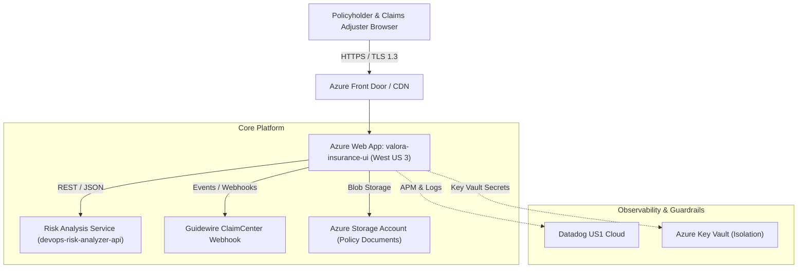
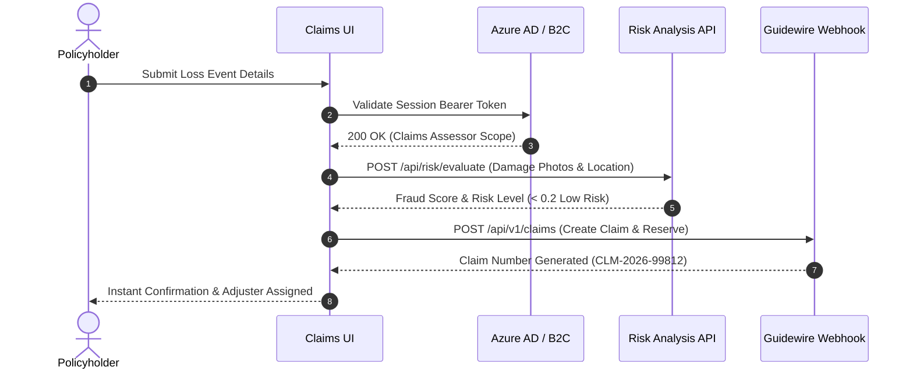

# Architecture & Design

The Claims UI Portal follows modern cloud-native, micro-frontend principles deployed inside a secure Azure Virtual Network perimeter.

## Architecture Diagram

---

## Component Topology

| Layer | Technology | Details |
| :--- | :--- | :--- |
| **Edge & CDN** | Azure Front Door | SSL Termination, Global Anycast, WAF Rules |
| **Web Tier** | Azure App Service (Linux) | Node/Nginx Container, Multi-instance auto-scaling (2-5 instances) |
| **API Gateways** | Azure API Management | JWT Authentication, Rate Limiting (500 req/min/client) |
| **Telemetry** | Datadog dd-trace-js | P95 latency tracking, HTTP request volume, continuous APM flamegraphs |

---

## Data Flow: First Notice of Loss (FNOL)

