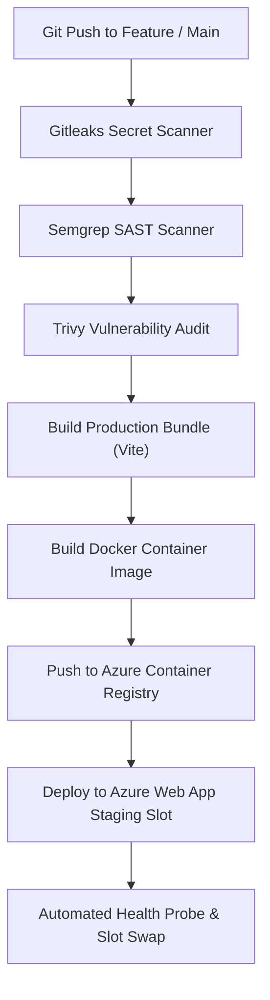

# Deployment & CI/CD Pipelines

Claims UI Portal is built and deployed using GitHub Actions with mandatory DevSecOps quality gates.

## Pipeline Workflow Architecture

---

## Required Azure App Settings & Secrets

The following environment variables are injected into the Azure Web App:

| Environment Variable | Description | Source |
| :--- | :--- | :--- |
| `NODE_ENV` | `production` | Container App Setting |
| `PORT` | `8080` | Azure Web App Container Port |
| `AZURE_KEY_VAULT_URI` | `https://valuemomentum-kv.vault.azure.net/` | Key Vault Isolation |
| `DD_ENV` | `production` | Datadog US1 APM Agent |
| `DD_SERVICE` | `valora-insurance-ui` | APM Service Tag |
